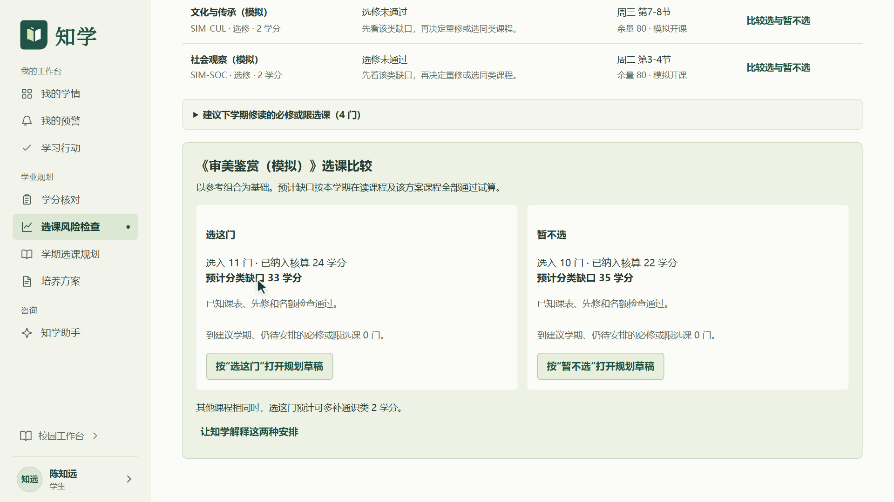
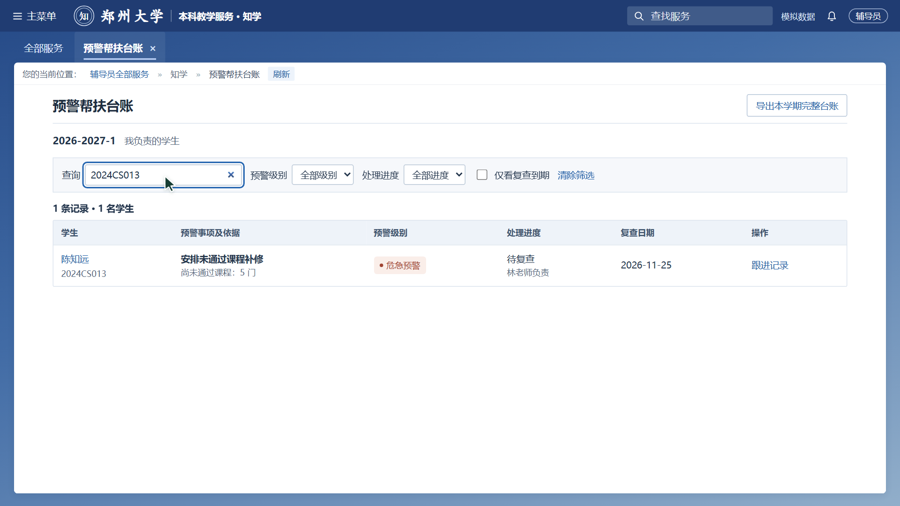

# 知学 · 学业预警与学情画像系统

学生收到预警后，可以查清哪几门课尚未通过，比较下学期两套课表各能补多少学分。辅导员能看到学生选择课程的理由，在同一条预警下记录反馈、安排复查。

项目以《基于大模型智能体的学业预警与学情画像系统》参加郑州大学首届 AI 智能体创新应用大赛，对应[校园真实需求 B1](data/b1-requirements.json)。

## 在线体验

| 入口 | 从哪里开始 |
| --- | --- |
| [知学独立版](https://zhixue-production-4c203c74.up.railway.app/) | 在登录页选「学生」，从「我的学情」查看预警。选「辅导员」可进入工作概览、学生选课方案和帮扶台账。 |
| [校园风格版](https://zhixue-production-4c203c74.up.railway.app/campus) | 从「全部服务」选「学生服务」或「辅导员服务」，再打开「学分核对明细」或「预警帮扶台账」。 |

两版共用业务数据和角色权限。在线体验使用计科、软工两个专业的 144 名模拟学生，公共账号的操作记录会保留。第一次访问可能需要等待服务启动，也可以[在自己的电脑上运行](#在电脑上运行)。

## 主要操作

下面是模拟学生陈知远（`2024CS013`）的一次补修规划。两张截图取自同一场本机演示，点击可以查看原图。

1. **查明预警依据。** 陈知远的累计绩点为 3.16。按课程去重、排除后来重修通过的记录后，他仍有 5 门课未通过，达到项目的危急预警阈值。在「知学助手」问「我为什么会收到危急预警？请帮我拟一份补修行动计划。」可以展开五项工具调用。学生点「采纳这份计划」后，三项行动写入自己的清单。
2. **只换一门课，比较学分差额。** 在「我的学情」找到《审美鉴赏（模拟）》并点「比较安排」。固定其他十门课，假设本学期在读课程和方案课程都通过，暂不选时各类别合计还缺 **35 学分**，选入后还缺 **33 学分**。少缺的 **2 学分**属于通识类。学生可以把所选组合、两份试算和自己的理由一起提交。
3. **由辅导员接着跟进。** 林老师（`C01`）在「学生选课方案」审核原方案。学生反馈准备核实补修班次后，老师在台账约定 **11 月 25 日**复查。换到校园风格版，按同一学号也能看到负责人、处理状态和复查日期。

| 独立版 · 学生比较两套课表 | 校园风格版 · 辅导员查看同一案例 |
| --- | --- |
|  |  |

## 实现与验证

- **核算依据。** 两个专业的培养方案整理为课程、学分类别和修读要求。系统结合学生的成绩、在读记录和所选修读路径核算缺口，并对选课组合检查时段、先修和容量。[培养方案原文](data/sources) · [结构化课程数据](data/curriculum.json) · [选课试算](server/selection_risk.py)
- **助手如何行动。** 在上面的案例中，助手依次读取学情、核算培养路径、拟定课程组合、核对预警证据，再生成待采纳的行动草案。两个前端共用 FastAPI 服务和 SQLite 台账。公开演示使用本地工具工作流，本机可接入支持工具调用的远程模型。[工具定义与执行](server/agent_runtime.py) · [模型接入实现](server/assistant.py)
- **学情画像。** 辅导员可在自己负责的学生中按课程通过情况查看 K-means 分组，识别可能需要同一门课答疑的学生。校园版用 ECharts 展示学期绩点走势。辅助预测按学生和时间留出样本，训练或测试数据的类别不足时，页面会说明暂缓出分的原因。[群体分析](server/analytics.py) · [预测可用条件](server/forecast.py)
- **已验证的结果。** 128 个预设分级案例全部得到期望等级，10 项边界检查通过。另将 20 种多风险情形分别用于两个专业，40 个案例均符合预期。这些结果衡量规则在模拟输入上的一致性。实际误报、漏报及帮扶效果仍需在授权样本上与辅导员的独立判断比对。[分级与边界报告](docs/validation.json) · [多风险报告](docs/support-validation.json) · [测试与验收脚本](tests)

## 在电脑上运行

准备 Python 3.12 或以上版本，下载并解压本仓库，或用 Git 克隆。Windows 双击 [start.bat](start.bat) 打开独立版，双击 [start-campus.bat](start-campus.bat) 打开校园风格版。首次启动会创建虚拟环境并联网安装依赖。

本机默认地址为 <http://127.0.0.1:8766>，校园版为 <http://127.0.0.1:8766/campus>。通过批处理启动的服务会在后台运行，用 [stop.bat](stop.bat) 停止。普通本机模式的数据保存在 `var/zhixue.sqlite3`，下次启动可继续上次的演练。

<details>
<summary>从终端启动或运行测试</summary>

在仓库根目录执行。Windows PowerShell 使用以下命令。

```powershell
python -m venv .venv
.\.venv\Scripts\python.exe -m pip install -r requirements.txt
.\.venv\Scripts\python.exe run.py
```

macOS 和 Linux 使用虚拟环境中的 `bin/python`。

```sh
python3 -m venv .venv
.venv/bin/python -m pip install -r requirements.txt
.venv/bin/python run.py
```

手动启动的服务在当前终端运行，按 Ctrl+C 停止。使用同一虚拟环境的 Python 可以运行全部单元与集成测试。以下为 Windows 命令。

```powershell
.\.venv\Scripts\python.exe -m unittest discover -s tests
```

</details>

## 演示账号

独立版的快捷入口可直接登录。手动登录下列模拟账号时，密码均为 `demo123`。要同时查看两种身份，可将学生端和辅导员端分别放在普通窗口与无痕窗口。

| 模拟账号 | 用途 |
| --- | --- |
| `2024CS013` | 陈知远，查看补修预警、比较选课、反馈进展 |
| `C01` | 林老师，审核学生选课方案、按学号查台账、约定复查 |
| `2024CS001` / `2024SE014` | 分别查看计科学生的正常学情、软件工程学生的培养要求 |
| `admin` | 普通本机模式的管理员，负责数据导入、规则查看和模型配置 |

## 接入真实大模型

<details>
<summary>配置本机模型服务与核对工具调用</summary>

使用普通本机模式启动服务。网页和配置文件都支持接入兼容 Chat Completions 且支持工具调用的服务。

1. 用 `admin` 登录，在「数据与设置 → 模型接入」选择「远程大模型」，填写 Base URL、模型名称和 API Key。服务会在 Base URL 后追加 `/chat/completions`。
2. 点「保存配置」和「测试已保存配置」，再用学生账号提问。展开工具过程，核对回答中的数字和引用。远程服务异常时会回退到本地流程，页面会显示本次回答所用模式。
3. 也可以复制 [.env.example](.env.example) 为本机的 `.env`，填写 `ZHIXUE_API_KEY`、`ZHIXUE_MODE`、`ZHIXUE_BASE_URL` 和 `ZHIXUE_MODEL`，再用 `run.py` 或启动脚本启动服务。已有系统环境变量优先于该文件。网页已保存的配置优先，环境配置补齐空项。数据库还没有配置时，由 `ZHIXUE_MODE` 决定运行模式。

网页输入的密钥只保留在当前服务内存中。`.env` 已加入 Git 忽略规则。共享体验模式（`--public-demo`）固定使用本地流程，管理员配置入口只在普通本机模式开放。模拟工具协议及回退测试可单独运行。

```powershell
.\.venv\Scripts\python.exe -m unittest discover -s tests -p "test_agent.py" -v
```

</details>

## 常见问题与使用范围

<details>
<summary>启动、数据导入、学分认定与团队开发</summary>

- **启动或版本问题。** 本机页面打不开时，查看启动提示和 `var/server.stderr.log`。遇到旧版服务占用端口，在旧目录运行 `stop.bat` 后启动当前版本，再按 Ctrl+F5 刷新。
- **导入和核对数据。** 管理员可在「数据与设置 → 数据导入」下载 CSV 模板。先导入学生和课程，再导入成绩、选课、开课、先修与数据覆盖声明。只有已核对完整来源时才把覆盖范围标为完整。遇到学分待核对，先区分未出分、缺少记录和未通过，再检查修读路径。
- **使用范围。** 当前使用项目预警规则和模拟开课安排。正式选课、学籍处理和毕业资格由学校教务系统认定。学校统一身份认证和正式教务数据仍待接入。

### 团队共同开发

协作者从[项目主仓库](https://github.com/sczczww/zhixue)建立自己的分支，完成测试后提交合并申请，由项目负责人审核、合并并更新网站。

</details>
