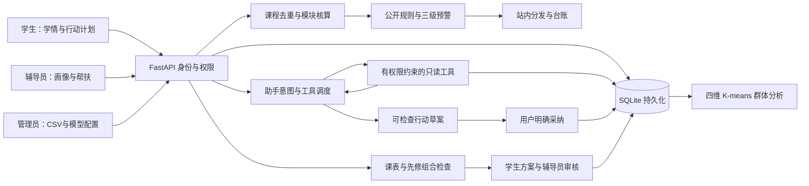

# 独立项目结构

业务代码从零编写于 `server/`，静态界面位于 `web/`。课程资料与原件位于 `data/`，运行数据库位于忽略版本管理的 `var/`。没有依赖工作区中的旧项目业务模块。

`core.py` 管理数据库和身份；`academic.py` 计算学情事实和预警；`planning.py` 核算培养路径、共享课程归属与选课组合；`planning_api.py` 处理方案保存、提交和审核；`analytics.py` 提供多维聚类及辅助异常观察；`agent_runtime.py` 管理有权限约束的多轮工具循环、对话上下文和行动草案；`assistant.py` 提供模型配置与对话接口；`imports.py` 负责输入校验和事务；`student_actions.py` 将个人行动、教师安排与反馈接入帮扶流程。

学分以学生、课程去重，一旦通过只计一次。总学分和各类别要求分别核算。成绩、选课使用不晚于当前学期的数据；未出分与未通过分别表达。历史资料缺失时，不把往期所有必修课认定为漏修。

每位学生每个学期每种风险最多一条预警，重复重算更新证据而不制造重复任务。风险条件解除不自动抹去帮扶记录；再次出现或恶化时重新提醒。分发记录和人工处置事件持久化。学生完成个人计划不改变正式台账状态。

服务端会话决定角色，查询范围逐接口、逐工具校验。密码使用加盐 scrypt；会话令牌只存摘要，设置 HttpOnly 和 SameSite Cookie。模型工具查询事实或生成待确认草案，不能自动更改学情或结案；任务只在显式采纳时创建。重新分配辅导员后，旧通知、对话历史和草案都再次检查权限。真实部署还需组织级身份、运行环境和教务数据接入验证。

模型接口遵循工具调用协议：把模型的tool_calls加入上下文，每个结果通过对应tool_call_id送回，再请求下一步。循环有轮次和调用次数上限。每轮回答有独立来源编号，明显无依据数字、无效来源或越权调用会被拒绝或回退；检查不保证所有自然语言语义均正确。

表结构升级为幂等、增量迁移。规划、偏好、提交和审核均有事件快照。路径变化只在语义实际改变时让已提交/批准方案退回复核，同值保存不制造重复通知。开课、先修导入不把来源标为学校官方；模拟记录与正式导入明确区分。
